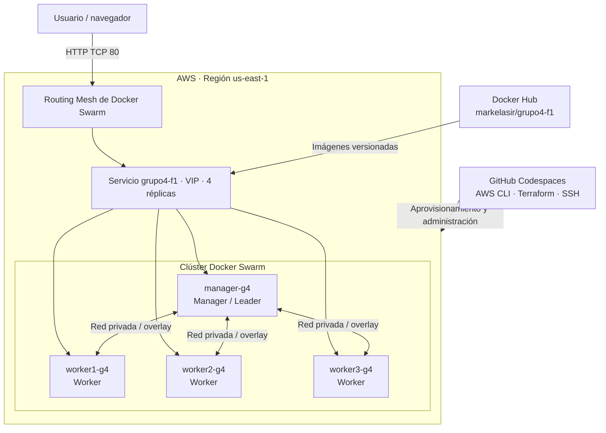

# CLOUD Reto 4 — Web en clúster Docker Swarm sobre AWS

Proyecto del **Grupo 4 de 2.º ASIR** para la asignatura CLOUD. El objetivo es desplegar una aplicación web relacionada con un evento de Fórmula 1 sobre una infraestructura de AWS, aprovisionada con Terraform y administrada mediante Docker Swarm.

La solución utiliza cuatro instancias EC2: un nodo manager y tres workers. La aplicación se ejecuta como un servicio replicado con cuatro réplicas, publicado por HTTP en el puerto 80.

---

## Contenido

- [Arquitectura](#arquitectura)
- [Tecnologías](#tecnologías)
- [Estructura del repositorio](#estructura-del-repositorio)
- [Configuración y puesta en marcha](#configuración-y-puesta-en-marcha)
- [Despliegue de la aplicación](#despliegue-de-la-aplicación)
- [Comprobaciones y pruebas](#comprobaciones-y-pruebas)
- [Direcciones IP públicas dinámicas](#direcciones-ip-públicas-dinámicas)
- [Seguridad](#seguridad)
- [Documentación y enlaces](#documentación-y-enlaces)

## Arquitectura



### Nodos del clúster

| Nombre | Función | Tipo de instancia |
|---|---|---|
| `manager-g4` | Manager y líder de Swarm | `t3.medium` |
| `worker1-g4` | Worker | `t3.small` |
| `worker2-g4` | Worker | `t3.small` |
| `worker3-g4` | Worker | `t3.small` |

La comunicación interna entre nodos se realiza mediante sus direcciones IP privadas. Las direcciones públicas las asigna AWS y pueden cambiar al detener y volver a iniciar las instancias.

### Servicio web

| Parámetro | Configuración comprobada |
|---|---|
| Servicio | `grupo4-f1` |
| Imagen actualmente desplegada | `markelasir/grupo4-f1:2.1` |
| Modo | Replicated |
| Réplicas | 4 |
| Red de aplicación | `red-app-g4` (overlay) |
| Puerto publicado | TCP 80 |
| Modo de publicación | `ingress` |
| Endpoint del servicio | `VIP` |
| Distribución | `spread=node.hostname` |
| Máximo de réplicas por nodo | 1 |

La etiqueta `2.1` corresponde a la versión desplegada al finalizar las últimas modificaciones. Las versiones `1.0` y `2.0` también se publicaron en Docker Hub para las pruebas de versionado y rollback.

## Tecnologías

- **Git y GitHub:** control de versiones y colaboración.
- **GitHub Codespaces / Dev Container:** entorno de administración.
- **AWS CLI:** consulta y administración de recursos de AWS.
- **Terraform:** infraestructura como código.
- **Amazon EC2:** máquinas virtuales que alojan el clúster.
- **SSH:** administración remota mediante claves y salto al manager.
- **Docker Engine:** construcción y ejecución de contenedores.
- **Docker Swarm:** gestión de nodos, servicios y réplicas.
- **Docker Hub:** publicación y distribución de imágenes.
- **Nginx Alpine:** servidor HTTP de la aplicación.

La imagen Docker utilizada se basa en `nginx:alpine` y sirve los archivos web incluidos en el repositorio. Aunque el árbol original de la aplicación contiene archivos PHP, el Dockerfile de este despliegue no incorpora PHP-FPM ni otro intérprete PHP; por tanto, este despliegue no debe describirse como un backend PHP funcional.

## Estructura del repositorio

```text
.
├── .devcontainer/          # Configuración de GitHub Codespaces
├── terraform/              # Proveedor, variables, EC2, Security Group,
│                           # outputs y script user_data.sh
├── app/
│   ├── Dockerfile          # Construcción de la imagen propia
│   ├── docker/             # Configuración Nginx e identificación del contenedor
│   └── grupo4-f1/           # Archivos de la aplicación web
├── config/                 # Ejemplo de configuración SSH
├── scripts/                # Scripts de comprobación y monitorización
├── diagramas/              # Diagramas de arquitectura
├── capturas/               # Evidencias organizadas por fase
├── practica-individual/    # Documentación de la práctica individual
├── README.md               # Presentación e instrucciones rápidas
├── proyecto.md             # Memoria técnica de las fases 0 a 5
└── gestion.md              # Reparto de tareas y reflexión del equipo
```

## Configuración y puesta en marcha

Los siguientes pasos describen el flujo de trabajo del proyecto. Las credenciales, claves privadas, variables locales y estados de Terraform no se incluyen en GitHub.

### 1. Abrir el entorno de trabajo

1. Clonar el repositorio privado o abrirlo desde GitHub Codespaces.
2. Esperar a que el Dev Container termine de preparar el entorno.
3. Comprobar que las herramientas están disponibles:

```bash
aws --version
terraform version
git --version
```

### 2. Configurar las credenciales de AWS

Iniciar el AWS Academy Learner Lab y cargar las credenciales temporales siguiendo las instrucciones del laboratorio. Comprobar que la identidad está disponible:

```bash
aws sts get-caller-identity
```

Las credenciales temporales caducan y deben renovarse cuando el laboratorio lo requiera. No deben copiarse en archivos versionados ni publicarse en GitHub.

### 3. Preparar Terraform

Desde la raíz del repositorio, revisar las variables declaradas en `terraform/variables.tf` y crear localmente `terraform/terraform.tfvars` con los valores del entorno. Este archivo está excluido del control de versiones.

Inicializar, formatear y validar la configuración:

```bash
terraform -chdir=terraform init
terraform -chdir=terraform fmt -check
terraform -chdir=terraform validate
terraform -chdir=terraform plan
```

Revisar el plan antes de crear o modificar recursos. Cuando se vaya a desplegar la infraestructura, aplicar los cambios de forma consciente:

```bash
terraform -chdir=terraform apply
```

### 4. Configurar el acceso SSH

El repositorio contiene un ejemplo de configuración en `config/ssh_config.example`. Copiarlo al archivo local `~/.ssh/config` y adaptar las direcciones `HostName` a las IP públicas actuales obtenidas de AWS. Proteger el archivo local:

```bash
chmod 600 ~/.ssh/config
```

La clave privada permanece en el equipo del usuario y no se sube al repositorio. El acceso a los workers se realiza mediante el manager como salto SSH (`ProxyJump`), utilizando sus direcciones privadas.

Comprobar el acceso al manager:

```bash
ssh manager-g4
```

### 5. Administrar el clúster

Una vez conectado al manager, se pueden consultar los nodos, servicios y tareas:

```bash
docker node ls
docker service ls
docker service ps grupo4-f1
```

La infraestructura y el servicio ya desplegados se administran desde el manager. No ejecutar `terraform destroy` salvo que se quiera eliminar deliberadamente la infraestructura y se hayan revisado antes sus consecuencias.

## Despliegue de la aplicación

El Dockerfile se encuentra en `app/Dockerfile`. Define Nginx Alpine como imagen base, copia los archivos de la web, añade la configuración de Nginx y el script que genera la información de identificación del contenedor.

### Versiones publicadas

- `markelasir/grupo4-f1:1.0`
- `markelasir/grupo4-f1:2.0`
- `markelasir/grupo4-f1:2.1` — versión incorporada al servicio después de añadir el panel de infraestructura.

Repositorio: [Docker Hub — markelasir/grupo4-f1](https://hub.docker.com/r/markelasir/grupo4-f1)

En el entorno utilizado, el cliente Docker no estaba instalado en Codespaces; la construcción y publicación se ejecutaron en el manager, transfiriendo primero el contenido de `app/` por SSH. Un ejemplo del procedimiento de construcción y publicación de la versión actual es:

```bash
tar -C app -czf - . | ssh manager-g4 '
  set -e
  mkdir -p ~/grupo4-f1-build
  tar -xzf - -C ~/grupo4-f1-build
  docker build --build-arg APP_VERSION=2.1 \
    -t markelasir/grupo4-f1:2.1 ~/grupo4-f1-build
  docker push markelasir/grupo4-f1:2.1
'
```

El servicio Swarm se denomina `grupo4-f1`, utiliza cuatro réplicas y publica TCP 80 mediante el modo `ingress`. El endpoint `/__container` devuelve JSON con la versión, hostname, rol, identificador Swarm e identificador del contenedor que atiende la consulta.

Para consultar la información de una réplica:

```bash
curl http://IP_PUBLICA_ACTUAL/__container
```

Sustituir `IP_PUBLICA_ACTUAL` por la dirección vigente de cualquiera de los nodos.

## Comprobaciones y pruebas

Las pruebas realizadas se documentan con sus evidencias en `proyecto.md` y en `capturas/`.

| Prueba | Qué se comprueba |
|---|---|
| E1 — Balanceo | Distintas réplicas responden a peticiones enviadas a una misma IP pública. |
| E2 — Escalado | El servicio se escala a 8, 12 y después 2 réplicas. |
| E3 — Autorreparación | Tras eliminar/detener un contenedor, Swarm crea una nueva tarea para recuperar el número deseado de réplicas. |
| E4 — Caída de worker | Se detiene una instancia worker y se comprueba que la web sigue respondiendo por la IP de entrada utilizada. |
| E5 — Reincorporación | El worker vuelve a `Ready` y se recupera la distribución de una réplica por nodo. |
| E6 — Drain | Se pone un nodo en mantenimiento y Swarm reubica sus tareas. Después se reactiva. |
| E7 — Actualización y rollback | Se actualiza la aplicación de 1.0 a 2.0 y se comprueba la reversión a la versión anterior. |
| E8 — Managers | Se prueba temporalmente la elección de un nuevo líder al detener el manager que ejercía como líder. |

La escalabilidad se realiza de forma manual mediante el estado deseado del servicio; no se ha configurado autoescalado automático basado en tráfico.

Comandos de consulta habituales:

```bash
docker service ls
docker service ps grupo4-f1
docker node ls
```

El script de monitorización se encuentra en `scripts/monitor-web.sh`.

## Direcciones IP públicas dinámicas

AWS puede asignar una nueva dirección IPv4 pública a una instancia EC2 cuando se detiene y vuelve a iniciar. Por ello, este README no fija IP públicas como valores permanentes.

Para consultar las direcciones actuales de los cuatro nodos:

```bash
aws ec2 describe-instances \
  --region us-east-1 \
  --filters \
    "Name=tag:Name,Values=manager-g4,worker1-g4,worker2-g4,worker3-g4" \
    "Name=instance-state-name,Values=running" \
  --query "Reservations[].Instances[].[Tags[?Key=='Name']|[0].Value,PublicIpAddress]" \
  --output table
```

Después de un reinicio de instancias, actualizar las direcciones públicas de los alias SSH locales. Si el panel de la aplicación utiliza las variables `PUBLIC_MANAGER_IP` y `PUBLIC_WORKER*_IP`, actualizar también esas variables del servicio para que la identificación del nodo de entrada siga siendo correcta.

Las direcciones privadas se utilizan para la comunicación interna del clúster y para el salto SSH hacia los workers.

## Seguridad

El repositorio incluye reglas en `.gitignore` para evitar versionar:

- Directorios `.terraform/`.
- Archivos `*.tfstate` y copias del estado.
- Archivos `*.tfvars` y variantes.
- Credenciales y directorios locales de AWS.
- Claves privadas SSH y archivos `.pem` / `.key`.
- Archivos `.env`.

Antes de hacer `git add` o publicar cambios, comprobar que no se han añadido archivos sensibles:

```bash
git status --short
git ls-files | grep -E 'terraform\.tfstate|terraform\.tfvars|\.pem$|id_rsa|id_ed25519' || true
```

No incluir nunca contraseñas, tokens de Docker Hub, claves privadas SSH, credenciales de AWS ni estados de Terraform en commits, capturas o documentación.

## Documentación y enlaces

- [Memoria técnica del proyecto — `proyecto.md`](proyecto.md)
- **Gestión del trabajo y reflexión:** `gestion.md` (documento complementario del equipo).
- [Índice de capturas](capturas/INDICE.md)
- [Diagrama de arquitectura](diagramas/arquitectura.mmd)
- [Imagen propia en Docker Hub](https://hub.docker.com/r/markelasir/grupo4-f1)

---

**Grupo 4 · 2.º ASIR · CLOUD Reto 4**
