# CLOUD Reto 4 — Informe técnico
## Despliegue de una aplicación web en un clúster Docker Swarm sobre AWS

**Ciclo:** 2.º ASIR  
**Asignatura:** CLOUD  
**Grupo:** 4  
**Plataforma:** AWS Academy Learner Lab · región `us-east-1`  
**Herramientas:** GitHub, GitHub Codespaces, AWS CLI, Terraform, SSH, Docker, Docker Swarm y Nginx.

---

## Índice

- [1. Introducción y arquitectura](#1-introducción-y-arquitectura)
- [2. Fase 0 — Entorno colaborativo y cliente remoto](#2-fase-0--entorno-colaborativo-y-cliente-remoto)
- [3. Fase 1 — Infraestructura con Terraform en AWS](#3-fase-1--infraestructura-con-terraform-en-aws)
- [4. Fase 2 — Acceso remoto por SSH](#4-fase-2--acceso-remoto-por-ssh)
- [5. Fase 3 — Clúster Docker Swarm](#5-fase-3--clúster-docker-swarm)
- [6. Fase 4 — Construcción y despliegue de la web](#6-fase-4--construcción-y-despliegue-de-la-web)
- [7. Fase 5 — Pruebas de orquestación](#7-fase-5--pruebas-de-orquestación)
- [8. Estado final y conclusión](#8-estado-final-y-conclusión)
- [9. Relación de evidencias](#9-relación-de-evidencias)

---

# 1. Introducción y arquitectura

## 1.1. Objetivo

El objetivo del reto es desplegar en AWS una aplicación web relacionada con un evento de Fórmula 1, utilizando infraestructura como código y un clúster Docker Swarm. La solución debe permitir administrar los servidores de forma centralizada, ejecutar varias réplicas de la aplicación y demostrar balanceo, escalado, recuperación ante fallos y mantenimiento.

La aplicación original fue proporcionada para el proyecto. El trabajo de despliegue consiste en preparar su imagen Docker, publicarla en Docker Hub y ejecutarla como un servicio distribuido en los cuatro servidores EC2.

## 1.2. Arquitectura desplegada

La infraestructura está formada por cuatro instancias EC2. Un nodo actúa como manager y líder del clúster; los otros tres son workers.

| Hostname | Rol | Tipo de instancia | Disco | IP privada documentada |
|---|---|---:|---:|---|
| `manager-g4` | Manager / Leader | `t3.medium` | 20 GB gp3 | `172.31.20.79` |
| `worker1-g4` | Worker | `t3.small` | 10 GB gp3 | `172.31.22.73` |
| `worker2-g4` | Worker | `t3.small` | 10 GB gp3 | `172.31.27.190` |
| `worker3-g4` | Worker | `t3.small` | 10 GB gp3 | `172.31.21.56` |

Las direcciones privadas se utilizan para la comunicación interna. Las direcciones públicas de EC2 son dinámicas y pueden cambiar al detener y volver a iniciar las instancias; por ello, no se consideran direcciones permanentes ni se fijan en este informe.

## 1.3. Recorrido de una petición web

1. El usuario accede mediante HTTP al puerto 80 de la IP pública de cualquiera de los cuatro nodos.
2. El Security Group permite la entrada TCP al puerto 80.
3. El puerto publicado del servicio Swarm utiliza el modo `ingress`.
4. El Routing Mesh de Swarm encamina la petición hacia una tarea disponible del servicio `grupo4-f1`.
5. La réplica ejecuta Nginx y devuelve la respuesta HTTP al navegador.

La IP pública por la que entra una petición no tiene por qué coincidir con el nodo donde se está ejecutando la réplica que la atiende. Esta distinción es fundamental para entender las pruebas de balanceo y alta disponibilidad.

## 1.4. Diagrama de arquitectura

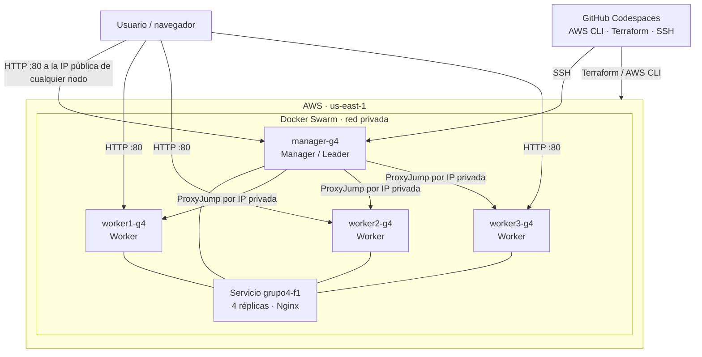

**Responsabilidad de cada componente:** Terraform aprovisiona AWS; SSH permite la administración remota; Docker construye y ejecuta contenedores; Swarm coordina las réplicas; Nginx sirve la aplicación web.

---

# 2. Fase 0 — Entorno colaborativo y cliente remoto

## 2.1. Creación del repositorio GitHub

Se creó un repositorio privado para el grupo 4 y el reto 4 de CLOUD. El repositorio centraliza el código, la infraestructura, la aplicación, los scripts, los diagramas y la documentación.

Se invitó a los integrantes del equipo y al profesor para facilitar el acceso al proyecto. También se habilitó el uso de Pull Requests por parte de los colaboradores.

**Evidencias:** creación del repositorio, invitaciones y configuración de Pull Requests.

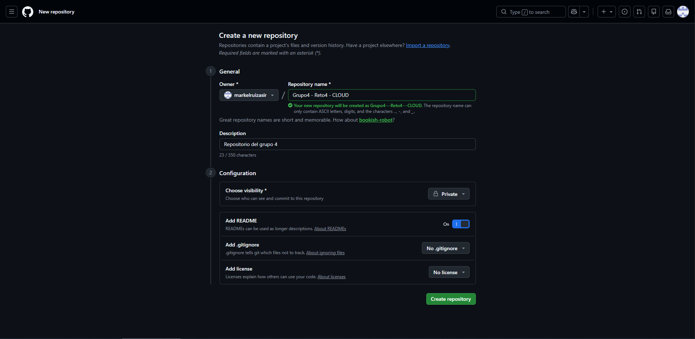

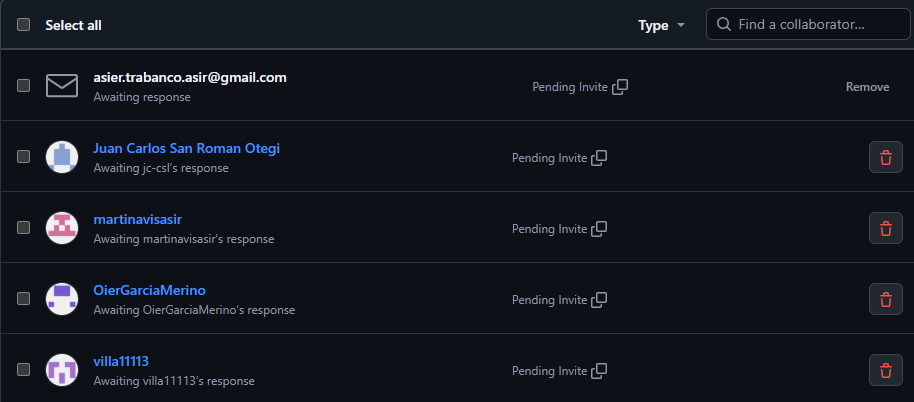

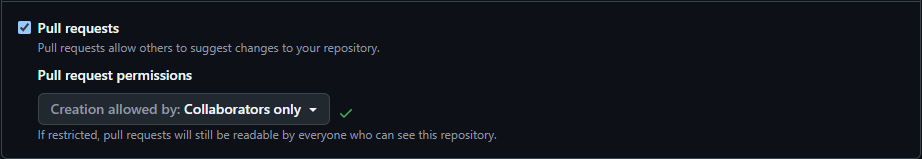

## 2.2. Configuración de GitHub Codespaces

Se preparó un entorno de desarrollo basado en un Dev Container, definido en `.devcontainer/devcontainer.json`.

El entorno incorpora las herramientas necesarias para administrar la infraestructura:

- AWS CLI para consultar y gestionar los recursos de AWS.
- Terraform para definir y aprovisionar la infraestructura como código.
- Git para controlar los cambios del repositorio.
- Extensión de HashiCorp Terraform para editar y validar los archivos HCL desde Visual Studio Code.

Se configuró el comando de creación del entorno para instalar o comprobar las herramientas al iniciar el Codespace.

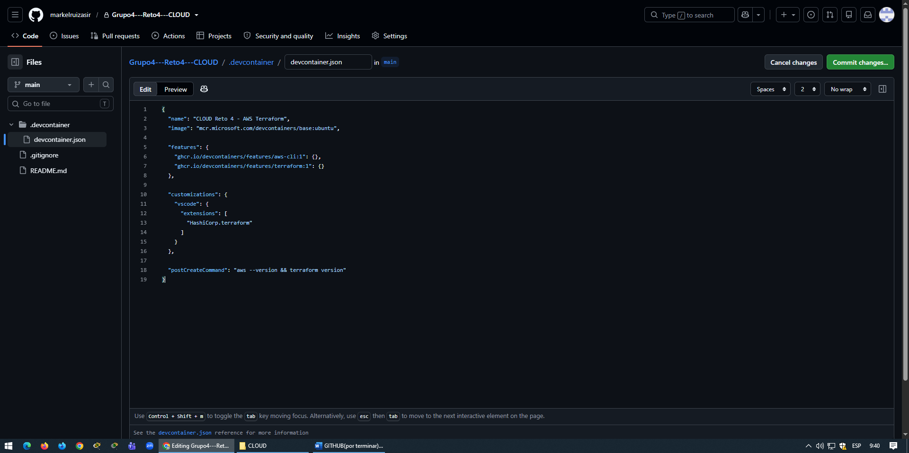

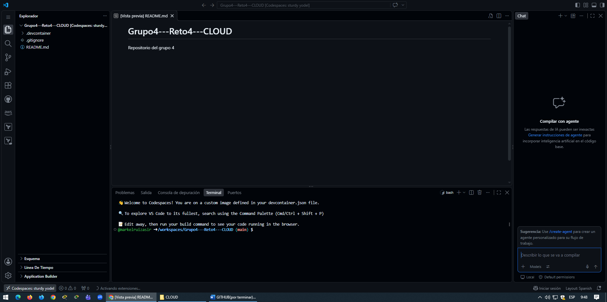

Una vez iniciado el entorno, se comprobaron las versiones:

```bash
aws --version
terraform version
git --version
```

Las capturas siguientes muestran la comprobación de las herramientas desde la terminal de Codespaces.

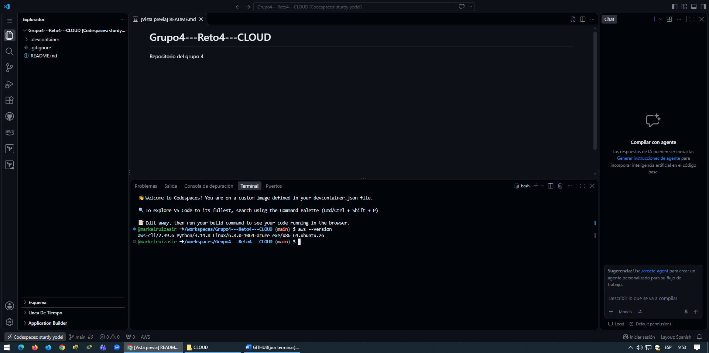

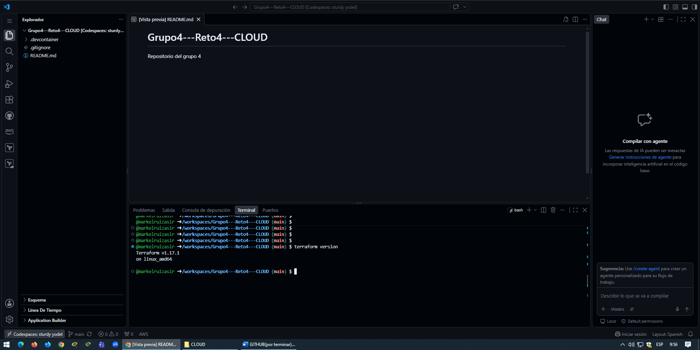


## 2.3. Organización del repositorio

La estructura del repositorio separa las responsabilidades del proyecto:

| Ruta | Contenido y finalidad |
|---|---|
| `.devcontainer/` | Configuración de Codespaces. |
| `terraform/` | Proveedor, variables, recursos AWS, outputs y script de arranque. |
| `app/` | Dockerfile, configuración Nginx y archivos de la web. |
| `config/` | Ejemplo de configuración SSH. |
| `scripts/` | Monitorización y comprobaciones. |
| `diagramas/` | Diagramas de arquitectura. |
| `capturas/` | Evidencias gráficas clasificadas por fase. |
| `practica-individual/` | Documentación individual. |
| `README.md` | Presentación e instrucciones rápidas. |
| `proyecto.md` | Memoria técnica de las fases 0 a 5. |
| `gestion.md` | Reparto del trabajo y reflexión. |

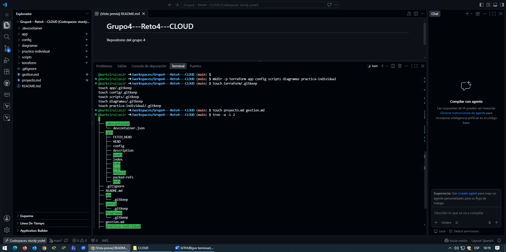

## 2.4. Control de versiones y seguridad del repositorio

Se utiliza Git para mantener el historial de modificaciones. Los archivos se preparan, confirman y sincronizan con el repositorio remoto mediante `git add`, `git commit` y `git push`.

El archivo `.gitignore` excluye archivos locales y sensibles, entre ellos:

- Directorios `.terraform/`.
- Archivos de estado `*.tfstate` y copias de estado.
- Archivos de variables `*.tfvars`.
- Credenciales locales de AWS.
- Claves privadas SSH.
- Archivos de entorno `.env`.

La clave pública SSH utilizada por Terraform sí puede almacenarse en el repositorio; la clave privada debe permanecer únicamente en el entorno local protegido.

Se comprobó qué archivos sensibles estaban versionados mediante `git ls-files` y el resultado no mostró archivos `tfstate`, `tfvars` ni claves privadas.

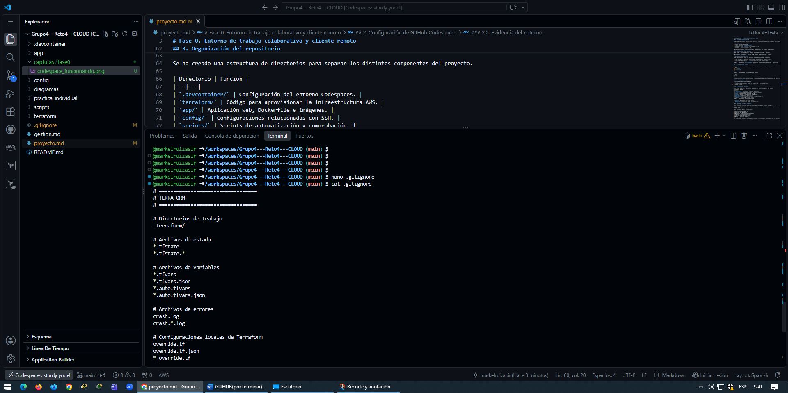

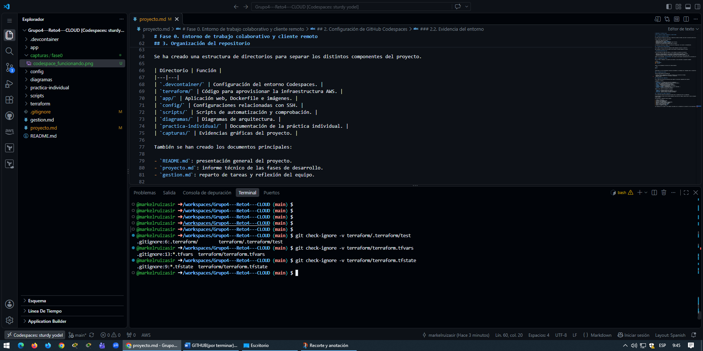

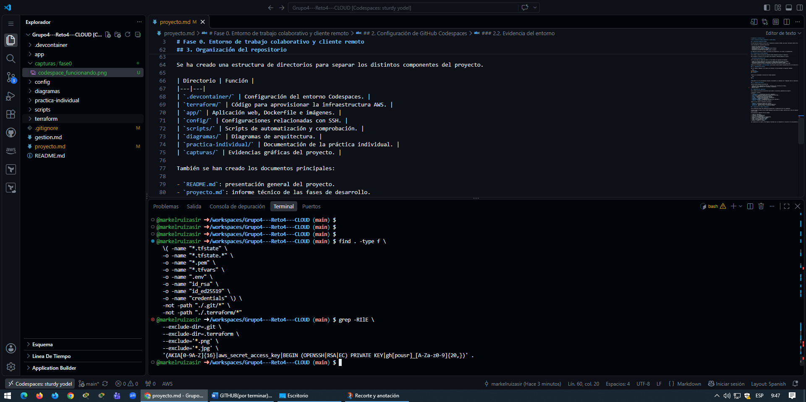

## 2.5. Resultado de la fase 0

Se dispone de un repositorio privado organizado y de un entorno Codespaces preparado para ejecutar AWS CLI, Terraform y Git. La estructura permite separar el código de infraestructura, la aplicación y las evidencias del proyecto.

---

# 3. Fase 1 — Infraestructura con Terraform en AWS

## 3.1. Organización del código Terraform

La infraestructura se definió mediante Terraform en el directorio `terraform/`. Se separaron los archivos por responsabilidad:

| Archivo | Función |
|---|---|
| `providers.tf` | Configuración del proveedor AWS y región. |
| `variables.tf` | Variables de infraestructura y validaciones. |
| `terraform.tfvars` | Valores concretos locales de las variables. |
| `main.tf` | Recursos de las instancias EC2. |
| `security_group.tf` | Reglas de entrada y salida. |
| `user_data.sh` | Configuración automática durante el arranque. |
| `outputs.tf` | Identificadores e IP de las instancias. |

El proveedor AWS se configura para la región `us-east-1`, utilizada por AWS Academy Learner Lab.

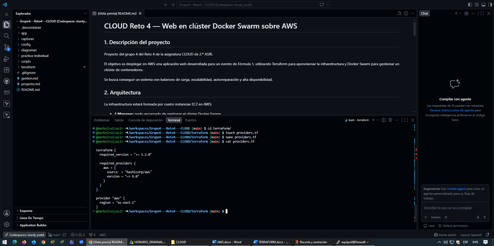

## 3.2. Inicialización, formato y validación

Antes de desplegar los recursos se preparó el directorio de trabajo de Terraform y se comprobó la configuración.

```bash
terraform fmt -check
terraform init
terraform validate
```

- `terraform fmt -check` comprueba el formato de los archivos HCL.
- `terraform init` inicializa el directorio y descarga los proveedores necesarios.
- `terraform validate` comprueba la sintaxis y coherencia de la configuración.

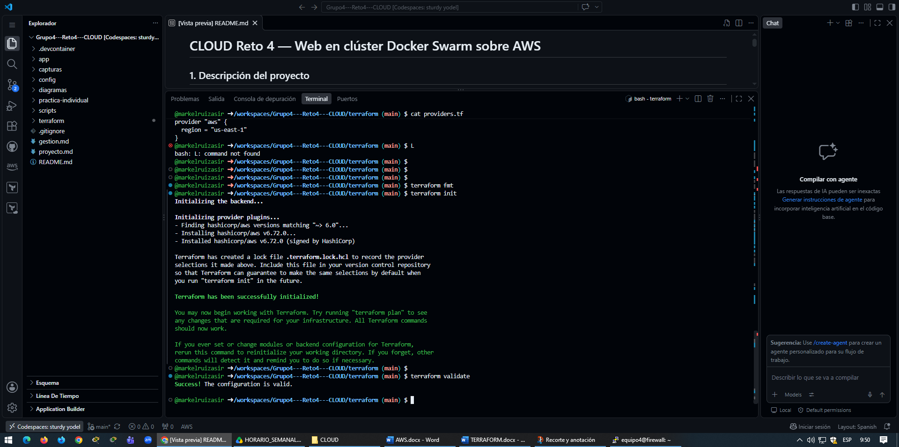

## 3.3. Definición de variables

Se parametrizaron los valores para evitar duplicar configuraciones y facilitar los cambios:

| Variable | Finalidad |
|---|---|
| `numero_grupo` | Identificador del grupo. |
| `ami_id` | AMI de Ubuntu Server 22.04. |
| `instance_type_manager` | Tipo de instancia del manager. |
| `instance_type_worker` | Tipo de instancia de cada worker. |
| `manager_disk_size` | Tamaño de disco del manager. |
| `worker_disk_size` | Tamaño de disco de los workers. |
| `ssh_allowed_cidr` | Rango CIDR autorizado para SSH. |

La AMI se obtuvo de las imágenes oficiales de Ubuntu publicadas por Canonical, cuyo identificador de propietario en AWS es `099720109477`.

El rango CIDR SSH se valida para evitar configuraciones abiertas a todo Internet.

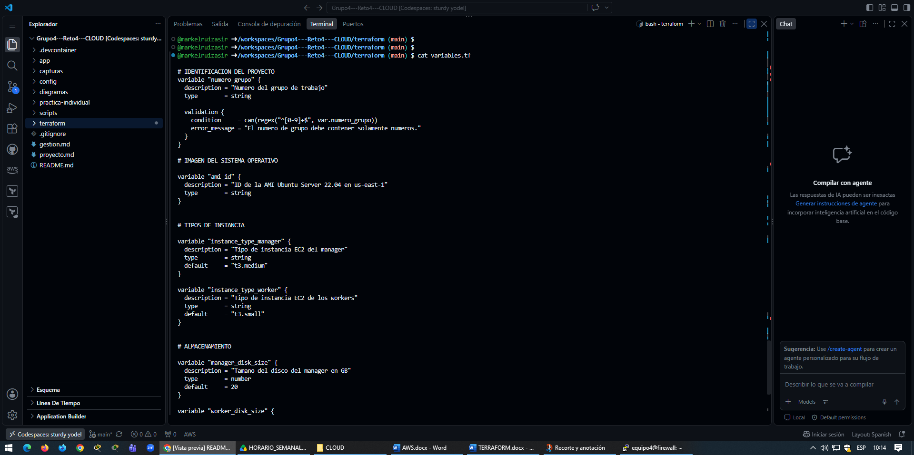

## 3.4. Creación de instancias EC2

Se definieron dos recursos principales:

**Manager:** recurso `aws_instance.manager`, con nombre `manager-g4`, tipo `t3.medium` y disco gp3 de 20 GB.

**Workers:** recurso `aws_instance.workers` con `count = 3`, de modo que los tres workers se generan a partir de una única definición de recurso. Cada uno utiliza tipo `t3.small` y disco gp3 de 10 GB.

Los recursos incorporan etiquetas para identificar el grupo, el proyecto, el hostname y la función de cada instancia.

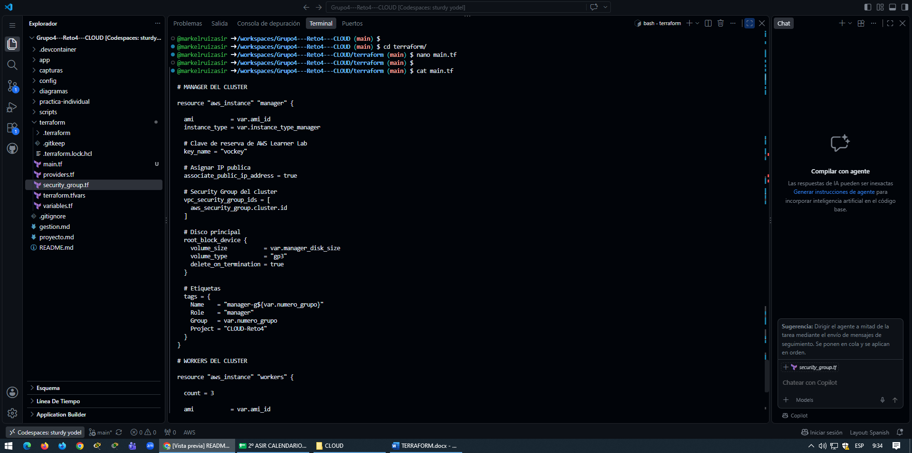

## 3.5. Configuración automática mediante User Data

El archivo `user_data.sh` se ejecuta durante la inicialización de cada instancia EC2. Su función es preparar los servidores de forma homogénea, sin tener que instalar y configurar manualmente cada máquina.

Entre las operaciones documentadas se encuentran:

1. Registrar la ejecución del script y detectar errores.
2. Establecer el hostname del manager o del worker correspondiente.
3. Configurar la zona horaria `Europe/Madrid`.
4. Preparar el directorio SSH y las claves públicas autorizadas.
5. Instalar dependencias y configurar el repositorio oficial de Docker.
6. Instalar Docker Engine, Docker CLI, containerd y complementos de Docker.
7. Habilitar e iniciar el servicio Docker.
8. Añadir el usuario de administración al grupo `docker`.
9. Comprobar la versión y el estado del servicio.

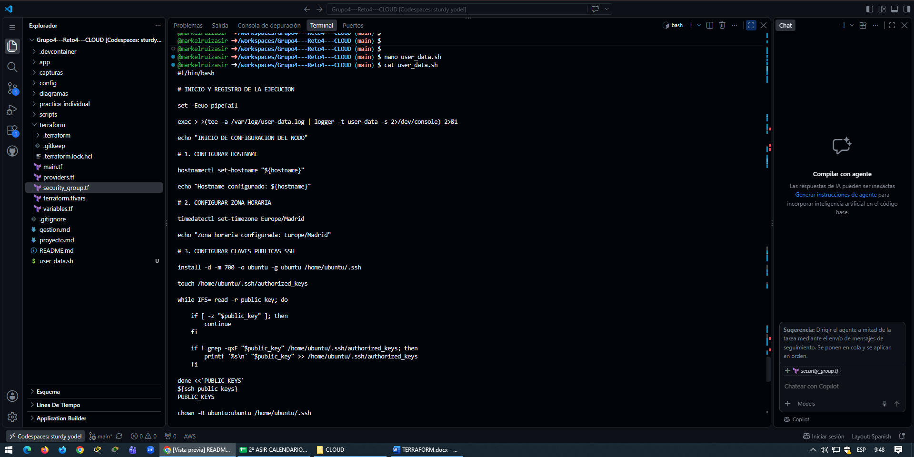

## 3.6. Security Group

Se creó un único Security Group para los cuatro nodos. Las reglas documentadas permiten el acceso administrativo y la comunicación necesaria para la web y Docker Swarm.

| Puerto / protocolo | Origen | Finalidad |
|---|---|---|
| TCP 22 | CIDR autorizado | Administración SSH. |
| TCP 22 | Security Group del clúster | Comunicación SSH interna cuando corresponde. |
| TCP 80 | Internet | Acceso HTTP a la web. |
| TCP 8080 | Internet | Puerto web alternativo indicado en el reto. |
| TCP 2377 | Security Group del clúster | Control de Swarm. |
| TCP/UDP 7946 | Security Group del clúster | Descubrimiento y comunicación entre nodos. |
| UDP 4789 | Security Group del clúster | Tráfico overlay VXLAN. |
| ICMP | Security Group del clúster | Comprobaciones de conectividad privada. |

Las reglas internas se limitan al entorno del clúster. El acceso SSH desde el cliente se restringe mediante el CIDR configurado.

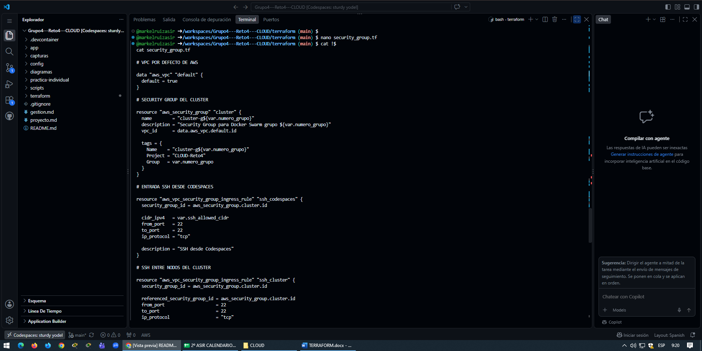

## 3.7. Outputs de Terraform

El archivo `outputs.tf` devuelve para cada nodo:

- ID de instancia EC2.
- Dirección IPv4 pública asignada por AWS.
- Dirección IPv4 privada.

Estos datos se utilizan para identificar los servidores, preparar la configuración SSH y comprobar el despliegue.

Las IP públicas pueden cambiar cuando se detienen y reinician instancias EC2. Por tanto, se consultan de nuevo cuando se inicia una sesión de AWS; no se almacenan como valores permanentes en la documentación.

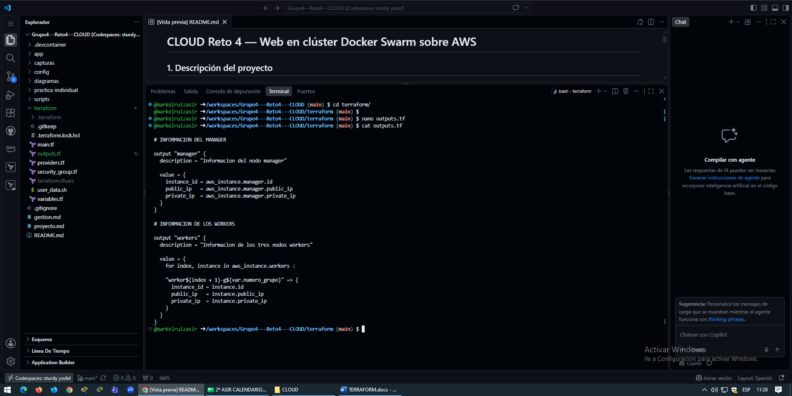

## 3.8. Planificación y aplicación

Antes de crear o modificar recursos se utiliza:

```bash
terraform plan
```

El plan permite revisar qué recursos se añadirán, modificarán o eliminarán antes de aplicar cambios.

Cuando la configuración está validada y el plan es correcto, se ejecuta:

```bash
terraform apply
```

Durante el proyecto se consultaron los cambios detectados por Terraform y se realizó una actualización de estado mediante `terraform apply -refresh-only -auto-approve` para sincronizar los outputs con las IP públicas que AWS había asignado tras reiniciar instancias.

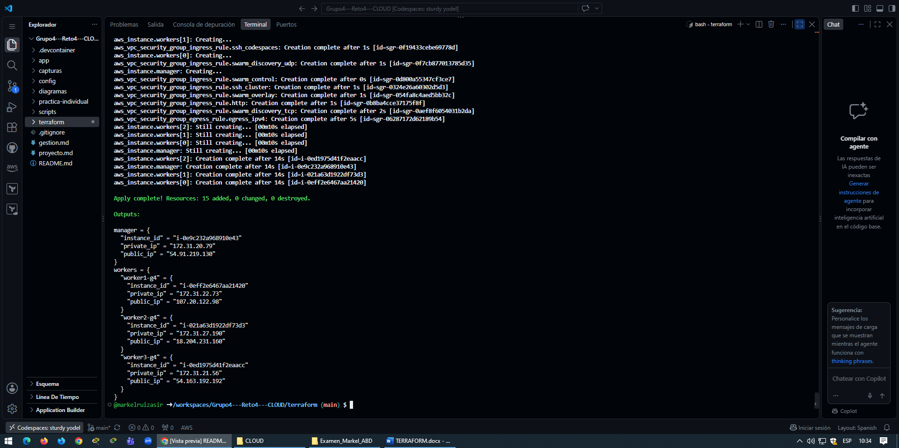

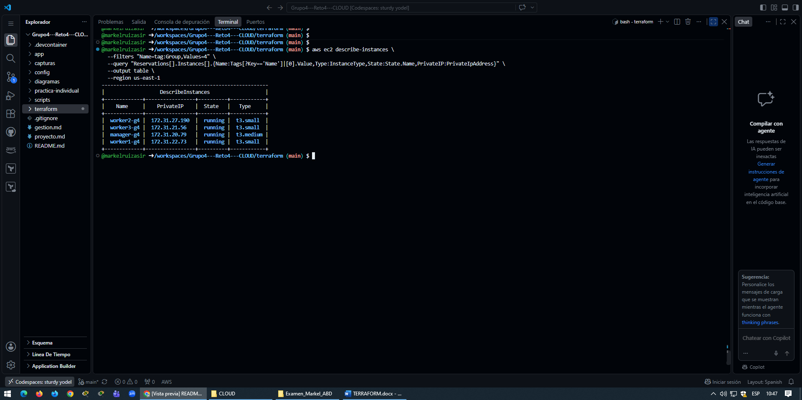

**Alcance de la evidencia A6:** las capturas disponibles muestran `terraform init`, `terraform fmt`, `terraform validate` y la aplicación inicial de la infraestructura (`terraform apply`). El comando `terraform plan` está explicado como parte del procedimiento, pero no se ha localizado una captura independiente con su salida. Tampoco se ha ejecutado ni documentado una destrucción final (`terraform destroy`), porque los recursos debían permanecer activos para completar las fases posteriores. Por tanto, A6 no queda acreditado al completo únicamente con las evidencias incluidas en esta memoria.

## 3.9. Resultado de la fase 1

Terraform permite aprovisionar las cuatro instancias EC2, aplicar etiquetas, configurar el acceso de red y preparar los servidores automáticamente mediante User Data. La información de cada instancia se obtiene a través de los outputs.

---

# 4. Fase 2 — Acceso remoto por SSH

## 4.1. Generación de clave SSH propia

Se generó una clave SSH propia de tipo Ed25519 protegida mediante una frase de paso. La clave privada permanece en el entorno Codespaces y la clave pública se incorpora a los servidores.

La clave pública utilizada por Terraform se encuentra en:

`terraform/keys/codespaces-principal.pub`

La clave privada no debe incluirse en el repositorio ni compartirse. En la configuración de los recursos EC2 se mantuvo `key_name = "vockey"` como clave de instancia de AWS Learner Lab, mientras que la clave pública propia también se incorporó a `authorized_keys` de los servidores. Por tanto, se comprobó el acceso con la clave propia, pero no se retiró completamente la referencia a `vockey` del recurso EC2. Este matiz debe tenerse en cuenta al valorar el requisito B1, que solicita sustituir `vockey`.

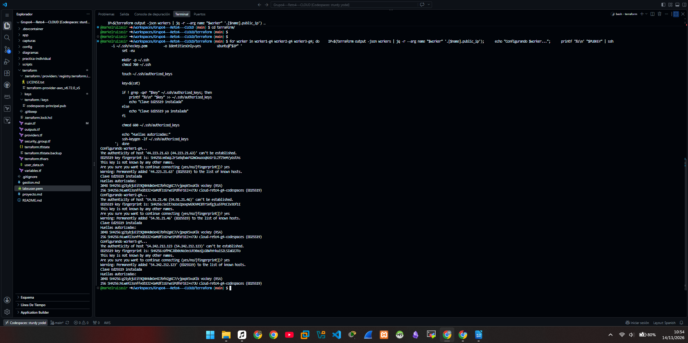

## 4.2. Uso de ssh-agent

Para no tener que introducir la frase de paso en cada conexión, se utiliza `ssh-agent` y se carga la identidad privada en memoria:

```bash
eval "$(ssh-agent -s)"
ssh-add ~/.ssh/cloud_reto4_ed25519
ssh-add -l
```

El agente facilita el uso de la clave, pero no copia ni publica la clave privada.

## 4.3. Archivo de configuración SSH y alias

Se creó una configuración local de SSH para conectarse utilizando nombres cortos, por ejemplo:

```bash
ssh manager-g4
```

Los alias permiten asociar hostname, usuario, dirección y clave de identidad sin tener que escribir todos los parámetros en cada conexión.

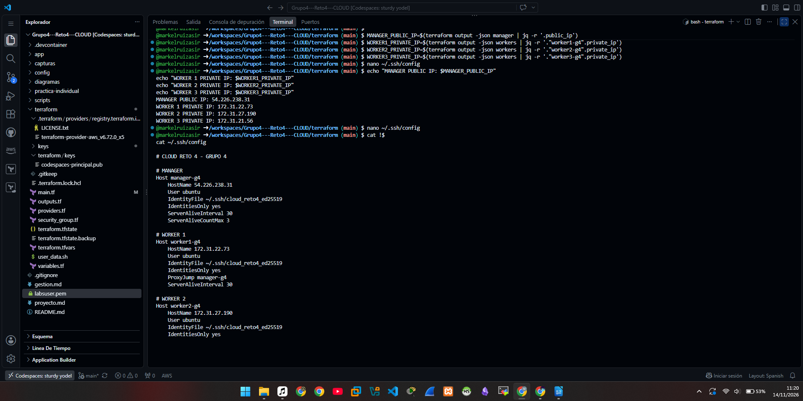

## 4.4. Acceso a workers mediante ProxyJump

Los workers se administran utilizando sus direcciones privadas y el manager como salto SSH. De esta forma, Codespaces establece una conexión con el manager y, a través de él, alcanza cada worker dentro de la red privada.

El mecanismo utilizado es `ProxyJump`.

```bash
ssh manager-g4
ssh worker1-g4
ssh worker2-g4
ssh worker3-g4
```

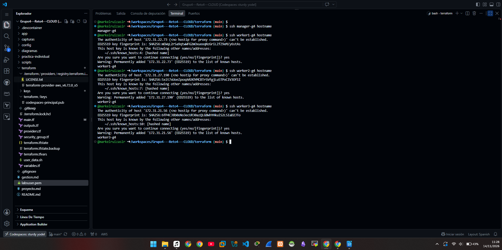

## 4.5. Administración simultánea y transferencia de archivos

Se realizaron comprobaciones de administración remota y copia de un archivo de prueba en los cuatro servidores. Después se verificó su presencia y se eliminaron los archivos de prueba.

Estas comprobaciones permiten confirmar que los nodos pueden administrarse desde el cliente y que la transferencia funciona mediante SSH/SCP.

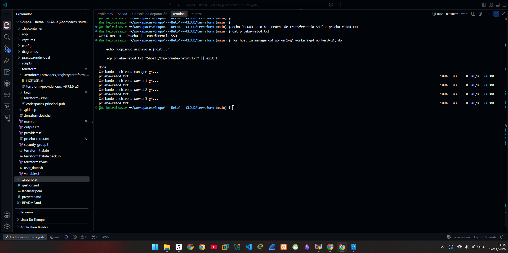

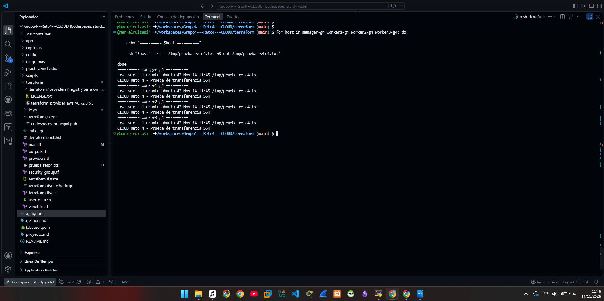

## 4.6. Endurecimiento del acceso SSH

Se comprobó la configuración efectiva de SSH en los servidores. Se ajustó el acceso para que:

- `PermitRootLogin no`: no se permite el inicio de sesión directo como root.
- `PasswordAuthentication no`: se deshabilita la autenticación por contraseña.
- `KbdInteractiveAuthentication no`: se deshabilita la autenticación interactiva por teclado.
- `PubkeyAuthentication yes`: se permite la autenticación mediante clave pública.

La configuración se comprobó con las opciones efectivas de `sshd` después de aplicar los cambios.

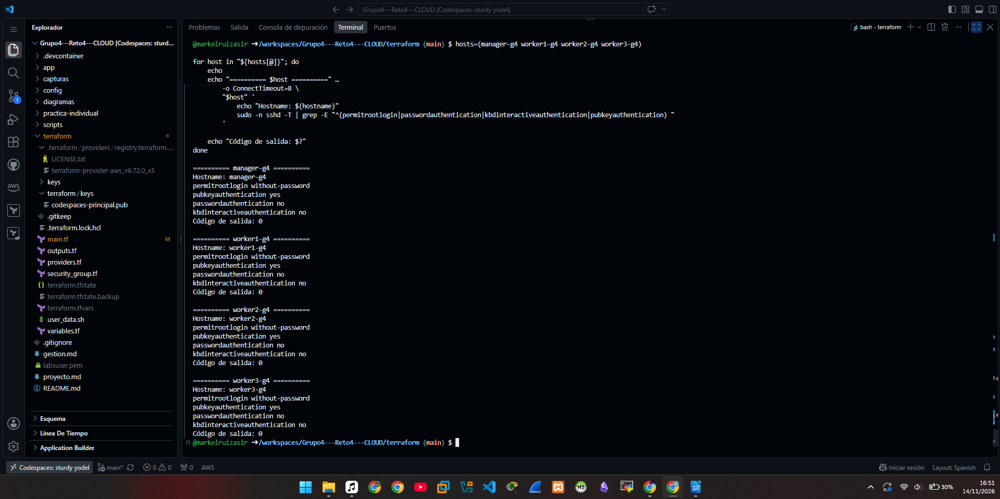

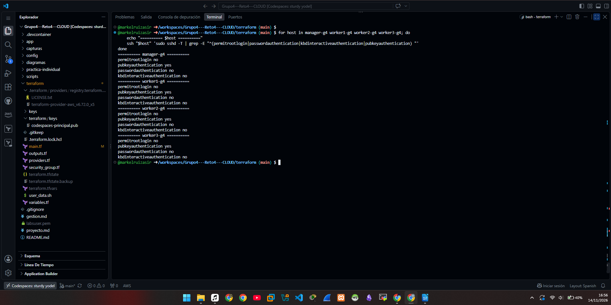

## 4.7. Resultado de la fase 2

Los cuatro servidores pueden administrarse de forma remota mediante claves SSH. Los workers son accesibles por IP privada utilizando el manager como salto, y se han aplicado restricciones para deshabilitar el acceso root y por contraseña.

---

# 5. Fase 3 — Clúster Docker Swarm

## 5.1. Comprobación de Docker en los cuatro nodos

Docker Engine se instaló automáticamente mediante el script User Data de Terraform. Se comprobó la versión y el estado del servicio en los cuatro servidores.

La versión observada durante las comprobaciones fue Docker Engine 29.9.3 y el servicio Docker se encontraba activo.

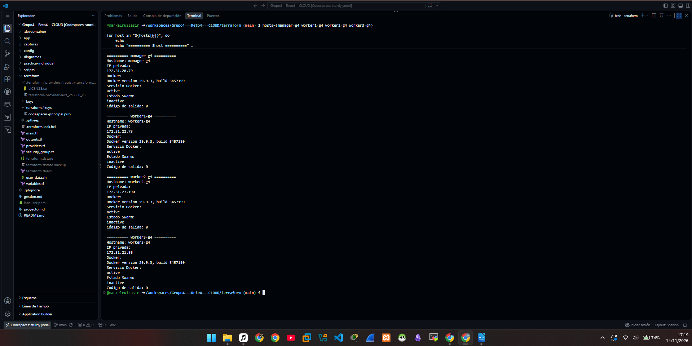

## 5.2. Conectividad mediante IP privada

Antes de crear el clúster se comprobaron las comunicaciones entre el manager y los workers mediante `ping` a sus direcciones privadas.

Las pruebas realizadas mostraron conectividad entre los nodos, sin depender de sus IP públicas.

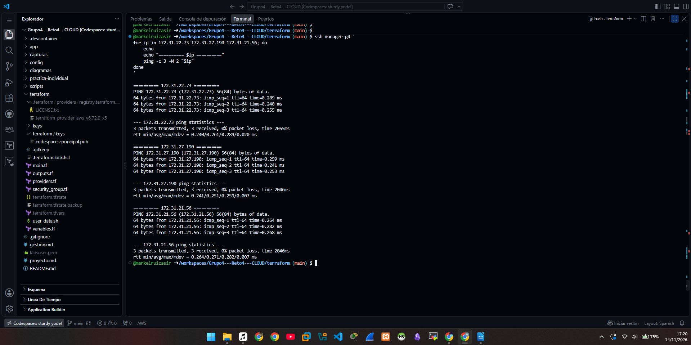

## 5.3. Inicialización del Swarm

Docker Swarm se inicializó en `manager-g4` utilizando la IP privada del manager:

`172.31.20.79`

El uso de la IP privada permite que la comunicación y el plano de control del clúster permanezcan dentro de la VPC de AWS.

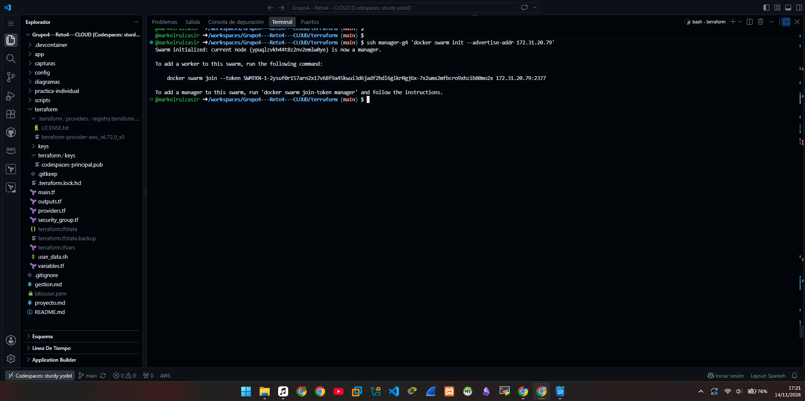

## 5.4. Sustitución de la red ingress y MTU

Se sustituyó la red ingress predeterminada por una red overlay personalizada denominada `red-g4`, configurada con MTU 1450.

La reducción de MTU tiene en cuenta la encapsulación adicional que utiliza VXLAN en las redes overlay. Ajustar el tamaño evita que los paquetes encapsulados superen el tamaño admitido por la red subyacente.

Se comprobó la configuración de la red después de recrearla.

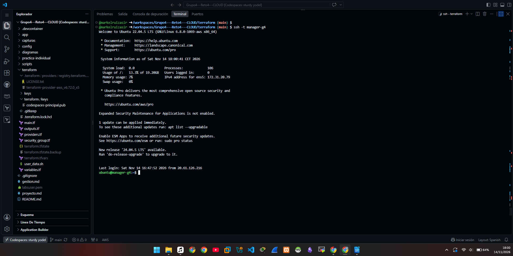

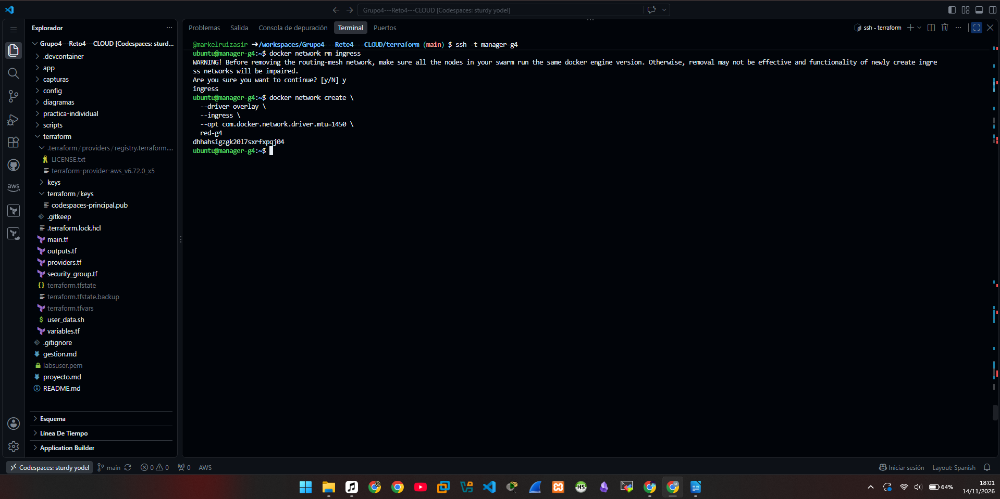

## 5.5. Incorporación de workers y estado del clúster

Se incorporaron `worker1-g4`, `worker2-g4` y `worker3-g4` al Swarm mediante los tokens de unión generados por el manager.

La comprobación se realizó mediante:

```bash
docker node ls
```

El estado final del clúster es:

| Nodo | Estado | Disponibilidad | Función |
|---|---|---|---|
| `manager-g4` | Ready | Active | Manager / Leader |
| `worker1-g4` | Ready | Active | Worker |
| `worker2-g4` | Ready | Active | Worker |
| `worker3-g4` | Ready | Active | Worker |

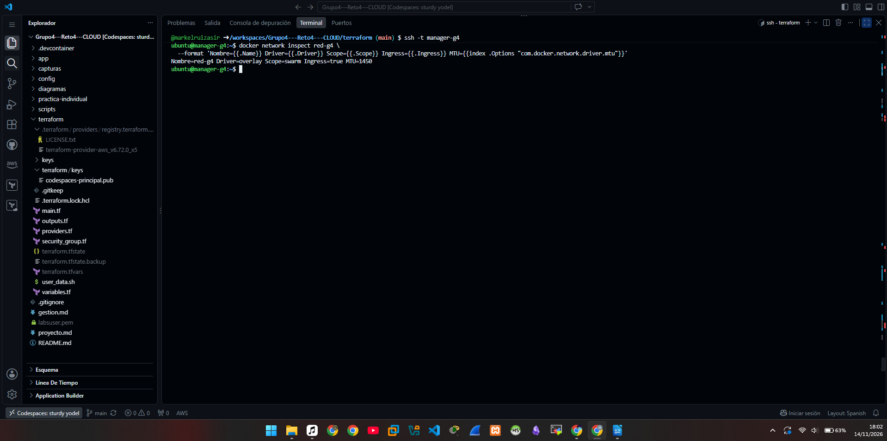

## 5.6. Red overlay de la aplicación

Además de la red ingress se creó una red overlay propia para la aplicación:

`red-app-g4`

La red permite la comunicación entre las tareas que forman el servicio web.

Se verificaron el nombre, el driver `overlay` y el ámbito `swarm` mediante los comandos de inspección de redes Docker.

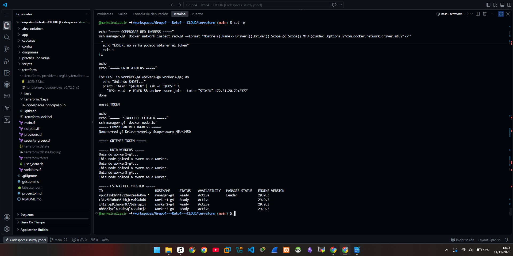

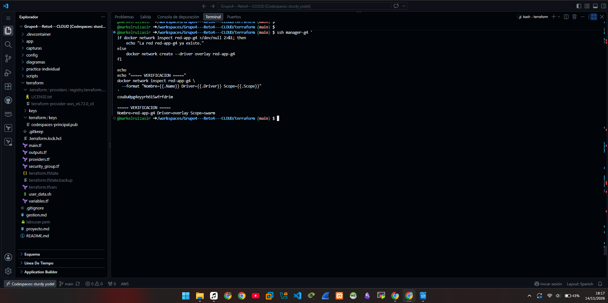

## 5.7. Resultado de la fase 3

El clúster Docker Swarm queda formado por cuatro nodos activos, con `manager-g4` como líder y tres workers unidos. La comunicación interna utiliza las direcciones privadas y la aplicación dispone de una red overlay propia.

---

# 6. Fase 4 — Construcción y despliegue de la web

## 6.1. Preparación de la aplicación

Se utilizó la aplicación web de Fórmula 1 proporcionada para el reto. Sus archivos se organizaron en `app/grupo4-f1/`.

El trabajo de esta fase se centró en preparar el contenedor y el servidor web para desplegar la aplicación en el clúster. No se desarrolló la aplicación original desde cero.

## 6.2. Dockerfile e imagen propia

El archivo `app/Dockerfile` utiliza `nginx:alpine` como imagen base. La construcción realiza las siguientes operaciones:

- Define `APP_VERSION` como argumento de construcción.
- Conserva la versión como variable de entorno del contenedor.
- Copia los archivos de la web a `/usr/share/nginx/html/`.
- Establece permisos de lectura.
- Incorpora la configuración personalizada de Nginx.
- Incorpora el script `40-container-info.sh`.
- Expone el puerto 80.

El Dockerfile permite construir imágenes etiquetadas por versión para publicarlas en Docker Hub y desplegarlas en todos los nodos.

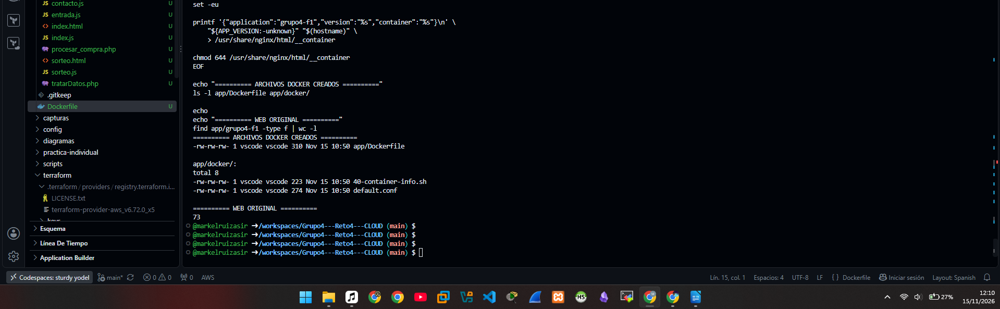

## 6.3. Mejora de la web: panel de información de infraestructura (versión 2.1)

Después de las pruebas iniciales se amplió la aplicación para que el propio navegador mostrase qué nodo recibe la conexión y qué contenedor responde realmente. Esta mejora se incorporó en la imagen `markelasir/grupo4-f1:2.1`.

La finalidad del cambio es hacer visible el funcionamiento interno de Docker Swarm durante las pruebas: el usuario puede entrar por la IP pública de un nodo y, gracias al Routing Mesh, ser atendido por una réplica que se ejecuta en otro servidor.

### 6.3.1. Información generada dentro de cada contenedor

Se modificó `app/docker/40-container-info.sh`. El script se ejecuta durante el arranque del contenedor mediante el directorio `/docker-entrypoint.d/` de la imagen oficial de Nginx.

El script obtiene los datos disponibles en las variables de entorno que recibe la tarea y genera el archivo:

`/usr/share/nginx/html/__container`

El JSON generado contiene:

- Nombre de la aplicación y versión (`APP_VERSION`).
- Identificador del contenedor, obtenido mediante `hostname`.
- Hostname del nodo donde se ejecuta la tarea (`NODE_HOSTNAME`).
- Rol del nodo, deducido del hostname: `Manager`, `Worker` o `Unknown`.
- Identificador del nodo de Docker Swarm (`NODE_ID`).
- Mapa de las direcciones públicas asignadas en ese momento a manager y workers (`PUBLIC_MANAGER_IP` y `PUBLIC_WORKER*_IP`).

El rol se determina a partir del nombre del nodo: los hostnames que comienzan por `manager-` se identifican como Manager y los que comienzan por `worker` como Worker. Finalmente, el script escribe el JSON en el directorio público de Nginx y establece permisos de lectura.

### 6.3.2. Publicación del endpoint mediante Nginx

Se modificó `app/docker/default.conf` para publicar el archivo JSON en una ruta específica:

`/__container`

La ubicación devuelve el contenido con tipo `application/json`. Así, además de cargar la web normalmente, es posible consultar directamente los metadatos de la réplica mediante `curl` o desde JavaScript.

Este endpoint no realiza el balanceo. Su función es proporcionar información de diagnóstico para identificar qué tarea ha atendido cada petición.

### 6.3.3. Cambios en HTML, CSS y JavaScript

Se modificaron los siguientes archivos de la página principal:

| Archivo | Cambio realizado |
|---|---|
| `app/grupo4-f1/index.html` | Se añadió un panel de infraestructura debajo del contador y antes del contenido principal. |
| `app/grupo4-f1/css/index.css` | Se añadió el diseño visual del panel: fondo oscuro, bordes rojos y distribución adaptable a distintos tamaños de pantalla. |
| `app/grupo4-f1/index.js` | Se añadió la función que consulta el endpoint y actualiza los datos mostrados. |

El panel muestra estos campos:

1. **IP pública utilizada:** hostname de la URL abierta en el navegador (`window.location.hostname`).
2. **Nodo de entrada:** se identifica comparando esa dirección con el mapa `public_nodes` recibido en el JSON.
3. **Nodo que atiende:** hostname real de la máquina donde se está ejecutando la réplica.
4. **Rol del nodo:** Manager o Worker.
5. **ID Swarm:** identificador del nodo dentro del clúster.
6. **Contenedor:** hostname/identificador de la instancia del contenedor que ha respondido.
7. **Versión:** etiqueta de versión incorporada en la imagen.

El JavaScript consulta `/__container` periódicamente, cada 10 segundos, y actualiza el panel con la información recibida. La IP de entrada se obtiene de la dirección que el usuario ha abierto; los datos del backend proceden del JSON generado dentro del contenedor.

Esta separación permite observar un comportamiento importante: por ejemplo, si el navegador entra por la IP pública del manager, el panel puede indicar que la petición ha sido atendida por `worker1-g4`, `worker2-g4` o `worker3-g4`. La dirección de entrada y el nodo que ejecuta la tarea no tienen por qué coincidir.

### 6.3.4. Variables de identificación proporcionadas por Docker Swarm

Al actualizar el servicio se añadieron las plantillas de interpolación de Swarm:

```text
NODE_HOSTNAME={{.Node.Hostname}}
NODE_ID={{.Node.ID}}
```

Swarm sustituye estas expresiones por los datos del nodo donde programa cada tarea. También se añadieron las variables `PUBLIC_MANAGER_IP` y `PUBLIC_WORKER*_IP`, usando las direcciones públicas vigentes en esa sesión de AWS.

Las IP públicas de EC2 pueden cambiar al detener y volver a iniciar una instancia. Por tanto, el mapa `PUBLIC_*` no es permanente: después de un cambio de direcciones se consultan las IP actuales mediante AWS CLI y se actualizan las variables del servicio. No se han fijado direcciones públicas como valores permanentes en la documentación.

### 6.3.5. Construcción y publicación de la versión 2.1

En el entorno Codespaces no estaba disponible Docker CLI, aunque sí se podía acceder por SSH al manager, donde estaba instalado Docker Engine. Por ese motivo, se transfirió el contenido de `app/` al manager y allí se construyó la imagen.

El procedimiento utilizado fue:

```bash
# Desde Codespaces: empaquetar app y transferirla al manager
 tar -C app -czf - . | ssh manager-g4 '
  set -e
  mkdir -p ~/grupo4-f1-build
  tar -xzf - -C ~/grupo4-f1-build
  docker build --build-arg APP_VERSION=2.1 \
    -t markelasir/grupo4-f1:2.1 ~/grupo4-f1-build
  docker push markelasir/grupo4-f1:2.1
'
```

La construcción se realizó con `APP_VERSION=2.1`, de forma que el endpoint pudiera mostrar la versión correspondiente. La imagen se publicó en Docker Hub bajo la etiqueta `2.1`.

La publicación quedó identificada por el digest:

`sha256:b8d525e9a039ac6b27af091c9b328a1d105253214cc6be256619c86d0c615280`

### 6.3.6. Actualización del servicio existente

Una vez publicada la imagen, se actualizó el servicio `grupo4-f1` para utilizar la etiqueta 2.1 y se incorporaron las variables de identificación de Swarm y las direcciones públicas vigentes en esa sesión.

La operación se realizó sobre el servicio existente mediante `docker service update`, no creando un servicio nuevo ni usando Docker Stack o Docker Compose. La actualización terminó con el mensaje `Service grupo4-f1 converged`.

Después se comprobó con `docker service ps grupo4-f1` que las cuatro tareas activas utilizaban `markelasir/grupo4-f1:2.1`, con una réplica en cada nodo.

### 6.3.7. Cómo se visualiza en la página

Al abrir la aplicación desde el navegador aparece el panel de infraestructura debajo del contador de la página principal. El panel permite ver la IP por la que entra el usuario y, de forma independiente, el nodo y el contenedor que han atendido la petición.

La captura siguiente corresponde a la versión 2.1 abierta desde el navegador mediante la IP pública que tenía asignada `worker1-g4` en el momento de la prueba. El panel muestra la dirección de entrada, el nodo identificado como punto de acceso, el hostname y rol del nodo que atiende, el ID de Swarm, el identificador del contenedor y la versión 2.1. En esta petición concreta, el nodo de entrada y el nodo que atendió coincidieron en `worker1-g4`; en otras peticiones, Routing Mesh puede dirigir la conexión a una réplica de otro nodo. La dirección IP visible es una dirección dinámica de esa sesión, no una dirección permanente.

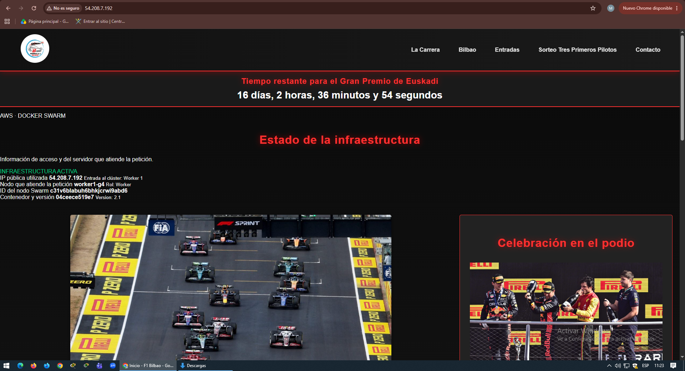

**Figura — Panel de infraestructura de la web en versión 2.1.** Se visualiza la IP pública utilizada en esa sesión, el nodo de entrada, el nodo que atiende la petición, el rol Worker, el identificador Swarm, el contenedor y la versión desplegada.

La comprobación técnica complementaria se puede realizar consultando el endpoint directamente:

```bash
curl -sS http://IP_PUBLICA_ACTUAL_DEL_NODO/__container
```

La respuesta JSON permite contrastar los datos que muestra el panel con el contenedor y nodo que han atendido la petición.

**Resultado:** la versión 2.1 incorpora un panel de diagnóstico en la web y un endpoint JSON que permiten identificar el nodo de entrada y la réplica que ha respondido. Esto facilita la demostración visual del balanceo y de la distribución de tareas del clúster.

## 6.4. Publicación de versiones en Docker Hub

Se construyeron y publicaron las imágenes propias en el repositorio:

[Docker Hub — markelasir/grupo4-f1](https://hub.docker.com/r/markelasir/grupo4-f1)

| Etiqueta | Estado comprobado | Uso |
|---|---|---|
| `1.0` | Publicada | Versión inicial y base de la prueba de rollback. |
| `2.0` | Publicada | Versión de actualización exigida por el reto. |
| `2.1` | Publicada | Versión posterior con el panel de información de infraestructura. |

La construcción se realizó temporalmente en el manager, transfiriendo los archivos desde Codespaces y publicando las imágenes en Docker Hub.

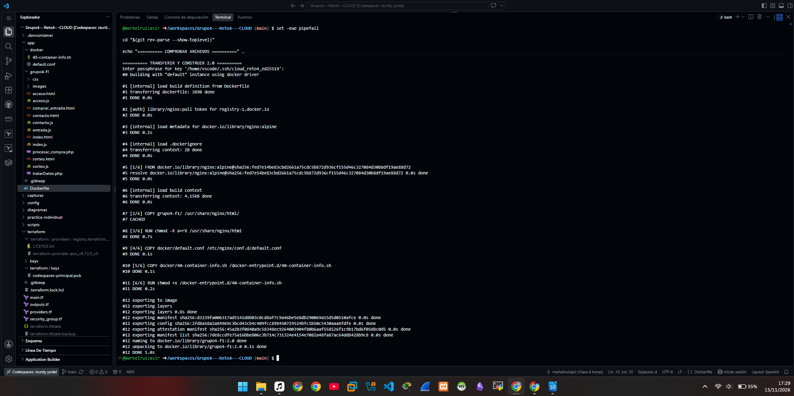

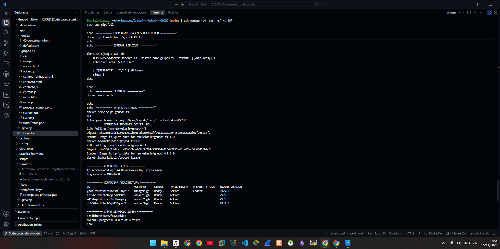

La versión 2.1 se publicó posteriormente para incorporar la información adicional de identificación del nodo y del contenedor. Es la versión que quedó desplegada al finalizar las pruebas.

## 6.5. Servicio Docker Swarm

La aplicación se desplegó como un servicio replicado llamado `grupo4-f1`.

Configuración final verificada mediante `docker service inspect`:

| Parámetro | Valor |
|---|---|
| Servicio | `grupo4-f1` |
| Imagen activa | `markelasir/grupo4-f1:2.1` |
| Modo | Replicated |
| Réplicas deseadas | 4 |
| Red | `red-app-g4` |
| Protocolo | TCP |
| Puerto publicado | 80 |
| Puerto de destino | 80 |
| Modo de publicación | `ingress` |
| Endpoint | `vip` |
| Preferencia | `spread=node.hostname` |
| Máximo de réplicas por nodo | 1 |

El modo `ingress` permite recibir conexiones en el puerto publicado de cualquiera de los nodos. El Routing Mesh encamina la conexión hacia una tarea disponible. El endpoint VIP es una dirección virtual interna del servicio y no debe confundirse con una IP pública fija.

La preferencia `spread=node.hostname` favorece la distribución por hostname. El límite máximo de una réplica por nodo se configuró para obtener una distribución de una tarea por servidor cuando hay cuatro nodos disponibles y cuatro réplicas.

El despliegue inicial se realizó desde Codespaces enviando por SSH al manager un bloque de comandos Bash que comprobaba las imágenes, las redes y el estado de los nodos y, finalmente, creaba el servicio mediante `docker service create`. Para conservar ese procedimiento en el repositorio como fichero de despliegue, se organizó el mismo flujo en `scripts/deploy-web.sh`. El script es una forma reproducible de documentar el procedimiento CLI utilizado; no implica que el despliegue original se realizara con otra herramienta.

La configuración activa se comprobó mediante `docker service inspect grupo4-f1` y `docker service ps grupo4-f1`. Después de las pruebas E5 y E6 se ajustó el límite máximo a una réplica por nodo y el orden de actualización final quedó en `stop-first`. El script conserva la configuración de creación inicial; la tabla de esta memoria describe la configuración final inspeccionada del servicio.

## 6.6. Política de reinicio y actualización

La política de reinicio final inspeccionada fue:

| Parámetro | Valor |
|---|---|
| Condición | `any` |
| Retraso | 5 segundos |
| Intentos máximos | 0 (sin límite) |
| Ventana | 120 segundos |

La configuración final de actualización inspeccionada fue:

| Parámetro | Valor |
|---|---|
| Paralelismo | 1 |
| Retraso | 5 segundos |
| Acción ante fallo | `rollback` |
| Monitorización | 5 segundos |
| Orden final | `stop-first` |

La política de reinicio indica a Swarm que debe recuperar tareas cuando finalizan. La configuración de actualización controla la sustitución de tareas al cambiar la imagen o forzar una nueva planificación.

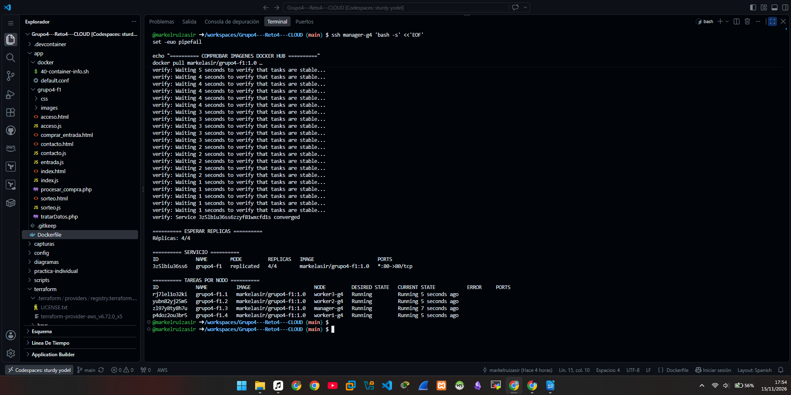

## 6.7. Acceso público e IP dinámicas

Se comprobó que la web era accesible mediante la IP pública de cada una de las cuatro instancias EC2.

AWS asigna IP públicas dinámicas en este entorno. Al detener y volver a iniciar una instancia, su dirección puede cambiar. Por ese motivo, la documentación no fija las IP públicas como si fueran permanentes.

Para consultar las direcciones actuales se utiliza AWS CLI:

```bash
aws ec2 describe-instances \
  --region us-east-1 \
  --filters \
    "Name=tag:Name,Values=manager-g4,worker1-g4,worker2-g4,worker3-g4" \
    "Name=instance-state-name,Values=running" \
  --query "Reservations[].Instances[].[Tags[?Key=='Name']|[0].Value,PublicIpAddress]" \
  --output table
```

Las direcciones obtenidas deben utilizarse para las comprobaciones de acceso de la sesión actual. Cuando AWS asigna direcciones nuevas, también deben actualizarse las variables `PUBLIC_MANAGER_IP` y `PUBLIC_WORKER*_IP` del servicio, utilizadas por el panel para reconocer el nodo de entrada.

El acceso por las cuatro IP públicas acredita que cada nodo permite alcanzar la aplicación. La captura de terminal muestra la consulta de las IP asignadas en aquella sesión y una respuesta HTTP 200 desde cada uno de los cuatro nodos. Las direcciones que aparecen en esa captura son históricas y no deben reutilizarse como valores permanentes.

Esta prueba es distinta de E1 y E4, donde se utiliza una misma IP pública de entrada durante toda la prueba para observar el comportamiento interno del clúster.

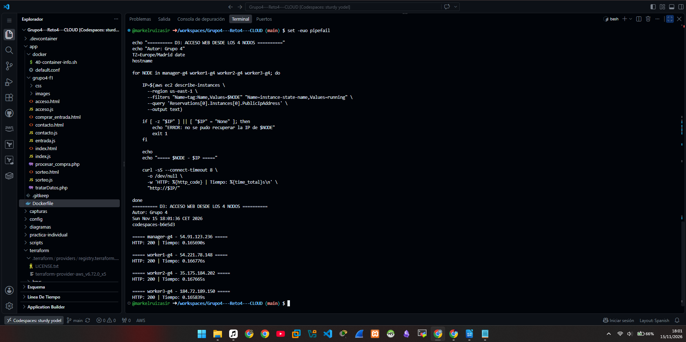

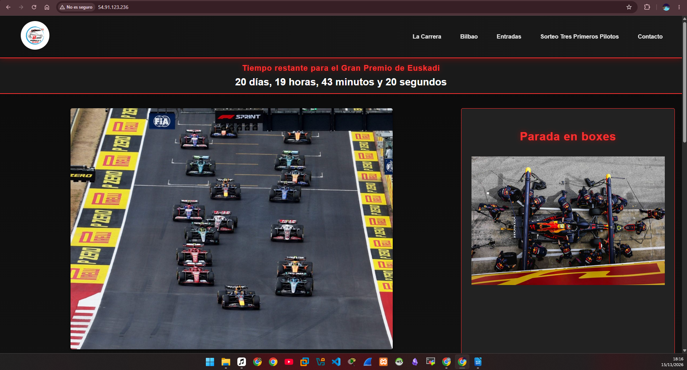

## 6.8. Resultado de la fase 4

Se publicaron las versiones 1.0 y 2.0 requeridas, además de la versión 2.1 utilizada en el estado final. El servicio `grupo4-f1` quedó configurado con cuatro réplicas, conectado a `red-app-g4` y publicado mediante TCP 80 en modo ingress.

---

# 7. Fase 5 — Pruebas de orquestación

## 7.1. Método de comprobación

Las pruebas de orquestación se realizaron observando tanto el estado del servicio como las respuestas HTTP de la aplicación.

Se utilizó el script `scripts/monitor-web.sh` para consultar el endpoint `/__container`, registrar el código HTTP, la versión y el identificador del contenedor que respondía.

Ejemplo de ejecución del monitor:

```bash
./scripts/monitor-web.sh "http://IP_PUBLICA_DEL_MANAGER" 30 1
```

Los parámetros representan la URL base, el número de consultas y el intervalo en segundos. El script permite observar las respuestas de las réplicas; no es el componente que realiza el balanceo.

## 7.2. E1 — Balanceo de carga

**Objetivo:** demostrar que varias peticiones que entran por una misma IP pública pueden ser atendidas por réplicas alojadas en distintos nodos.

Se ejecutó el monitor contra la IP pública del manager, manteniendo la misma dirección de entrada durante la prueba. Se obtuvieron 30 respuestas HTTP 200 y se identificaron cuatro identificadores de contenedor distintos.

Posteriormente se repitió la prueba con 20 peticiones HTTP independientes a la misma IP pública. El resultado mostrado en la terminal fue:

| Nodo que atendió | Peticiones de la segunda comprobación |
|---|---:|
| `manager-g4` | 5 |
| `worker1-g4` | 5 |
| `worker2-g4` | 5 |
| `worker3-g4` | 5 |
| **Total** | **20** |

La prueba demuestra que no es necesario entrar por la IP pública de cada worker para recibir respuestas de sus contenedores. El usuario puede conectarse a una sola IP de entrada y Swarm puede encaminar la petición a otra réplica disponible.

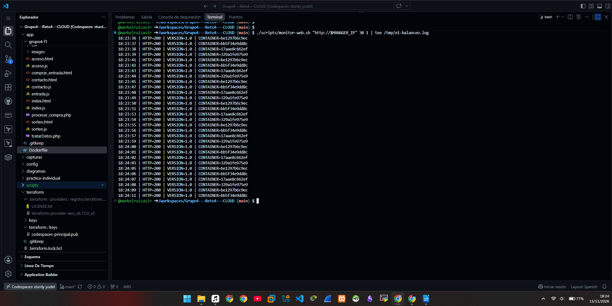

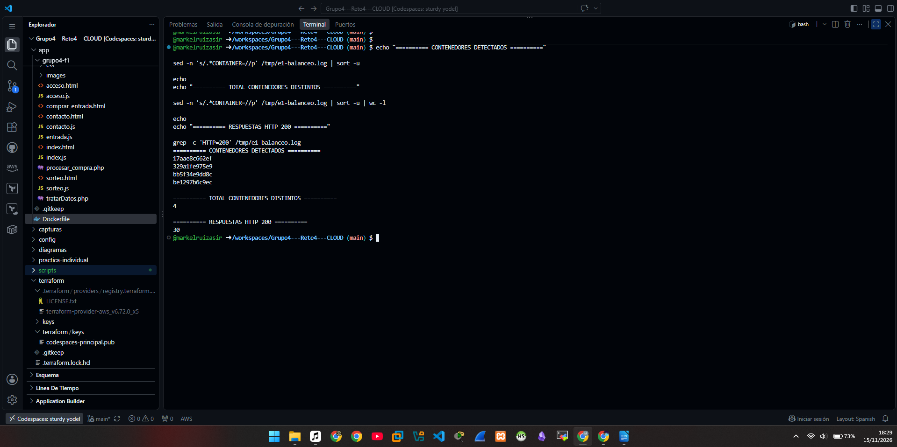

**Resultado:** se identificaron cuatro contenedores distintos respondiendo a peticiones recibidas por la IP pública del manager. En la repetición adicional de 20 peticiones se observaron cinco respuestas por cada nodo.

## 7.3. E2 — Escalado de réplicas

**Objetivo:** comprobar que el servicio puede aumentar y reducir el número deseado de tareas.

Se inició la monitorización y se modificó el número de réplicas del servicio:

```bash
docker service scale grupo4-f1=8
docker service ls

docker service scale grupo4-f1=12
docker service ls

docker service scale grupo4-f1=2
docker service ls
```

Después de cada orden se comprobó el número de réplicas deseadas y el estado de las tareas. Swarm crea las tareas adicionales o retira las sobrantes hasta converger al número solicitado.

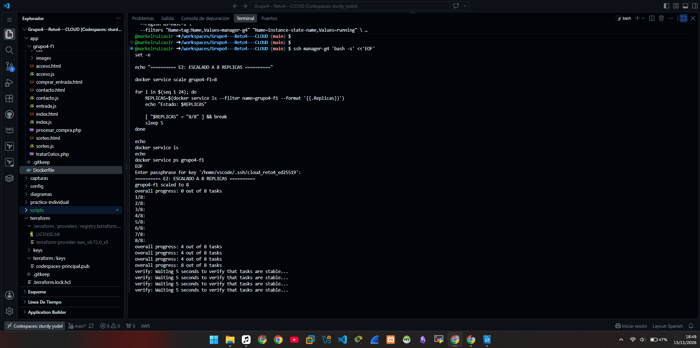

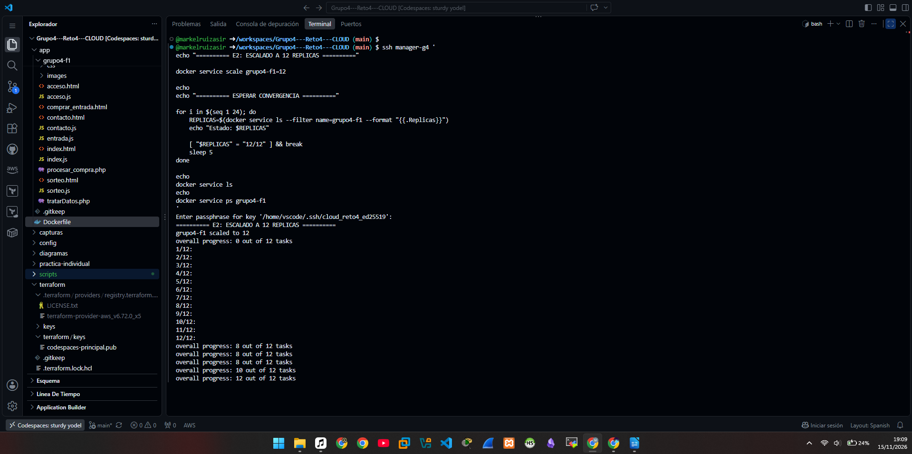

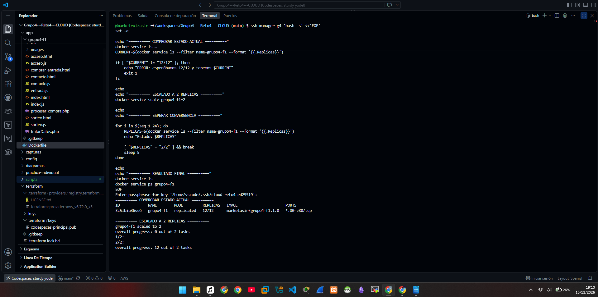

Al finalizar las pruebas se restauró el servicio a cuatro réplicas para continuar con las siguientes comprobaciones.

**Resultado:** se realizaron las operaciones de escalado a 8, 12 y 2 réplicas y se restauró el estado de cuatro réplicas.

## 7.4. E3 — Autorreparación al eliminar un contenedor

**Objetivo:** comprobar que Swarm detecta la pérdida de una tarea y crea otra para mantener el número deseado de réplicas.

Se identificó un contenedor de la aplicación y se provocó su finalización manual mediante `docker kill`.

En la comprobación reciente se detuvo el contenedor `6e69ba01bb16`, que se encontraba alojado en `manager-g4`:

```bash
docker kill 6e69ba01bb16
sleep 15
docker service ps grupo4-f1
curl -sS http://IP_PUBLICA_DEL_MANAGER/__container
```

Swarm registró la tarea anterior como fallida (código de salida 137) y creó una nueva tarea para mantener el estado deseado del servicio. La petición HTTP posterior respondió con la información de un contenedor nuevo.

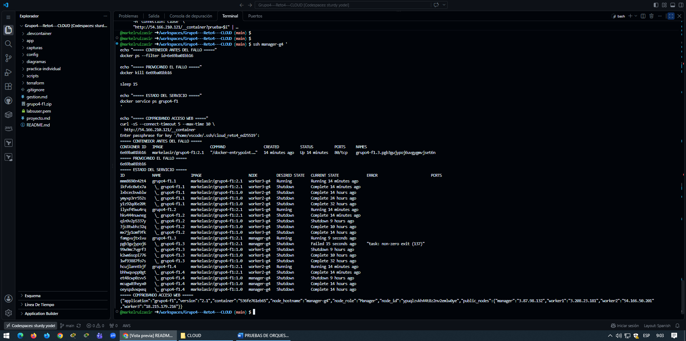

**Resultado:** la tarea fallida fue sustituida y el servicio mantuvo sus cuatro réplicas.

## 7.5. E4 — Alta disponibilidad ante la caída de un worker

**Objetivo:** demostrar que la aplicación sigue respondiendo cuando una instancia worker deja de estar disponible.

Se seleccionó `worker3-g4` y se detuvo su instancia EC2 desde AWS CLI. La parada fue intencionada y simuló la caída abrupta de un nodo.

Una vez transcurrido el tiempo de detección, se consultó el estado del clúster y de las tareas mediante:

```bash
docker node ls
docker service ps grupo4-f1
```

`worker3-g4` apareció como `Down`. Las cuatro tareas del servicio siguieron en ejecución en los nodos disponibles; al no estar disponible worker3, Swarm colocó tareas en los nodos supervivientes.

A continuación se comprobó la aplicación utilizando la misma IP pública del manager que se había utilizado como punto de entrada. La respuesta JSON indicó que la petición había sido atendida por una réplica de `worker2-g4`. Las IP que aparecen dentro del JSON de esta captura corresponden al mapa configurado para aquella sesión de prueba; AWS puede asignar otras direcciones en sesiones posteriores y el mapa del servicio se actualizó después con las direcciones vigentes.

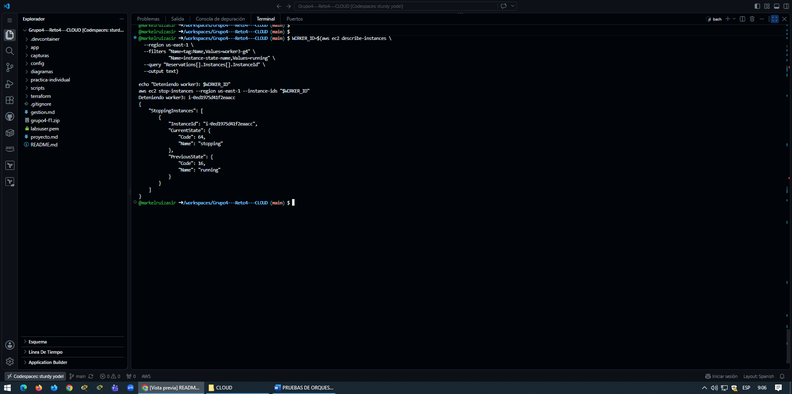


**Resultado:** pese a la caída de `worker3-g4`, se mantuvo el acceso HTTP por la misma IP pública de entrada y el servicio conservó sus cuatro tareas activas.

## 7.6. E5 — Reincorporación y reequilibrio

**Objetivo:** recuperar el worker detenido y volver a distribuir las cuatro réplicas entre los cuatro nodos.

Se volvió a iniciar la instancia EC2 de `worker3-g4` y se esperó a que AWS indicara que la instancia estaba disponible. Después se consultó el clúster:

```bash
docker node ls
docker service ps grupo4-f1
```

El nodo volvió a aparecer como `Ready` y `Active`. La primera planificación después del arranque no colocó automáticamente una réplica en cada servidor: el servicio seguía teniendo cuatro tareas, pero dos podían quedar temporalmente en el mismo worker.

Para recuperar la distribución uno por nodo se forzó una actualización y se configuró el límite máximo de una réplica por nodo:

```bash
docker service update \
  --force \
  --replicas-max-per-node 1 \
  --update-parallelism 1 \
  --update-delay 5s \
  --update-order stop-first \
  grupo4-f1
```

La comprobación final mostró una tarea en cada nodo:

| Nodo | Réplicas activas |
|---|---:|
| `manager-g4` | 1 |
| `worker1-g4` | 1 |
| `worker2-g4` | 1 |
| `worker3-g4` | 1 |


**Resultado:** worker3 volvió a estar disponible y se recuperó la distribución equilibrada de cuatro réplicas, una por nodo.

## 7.7. E6 — Mantenimiento mediante Drain

**Objetivo:** comprobar que un nodo puede ponerse en mantenimiento y evacuar sus tareas sin perder el servicio.

Se puso `worker2-g4` en modo mantenimiento. Para permitir que las cuatro tareas pudieran reubicarse temporalmente entre los otros tres nodos, se quitó durante la prueba el límite de una réplica por nodo. Después se activó `Drain`:

```bash
docker service update --replicas-max-per-node 0 grupo4-f1
docker node update --availability drain worker2-g4
```

Se consultó `docker node ls` y `docker service ps grupo4-f1`. El nodo apareció con disponibilidad `Drain`, mientras que las cuatro tareas se encontraban ejecutándose en los otros nodos. También se comprobó que la aplicación respondía por la IP pública del manager.


Al finalizar, se restauró el nodo y la distribución habitual:

```bash
docker node update --availability active worker2-g4
docker service update \
  --force \
  --replicas-max-per-node 1 \
  --update-parallelism 1 \
  --update-delay 5s \
  --update-order stop-first \
  grupo4-f1
```

**Resultado:** se comprobó el modo Drain, la evacuación de tareas y la restauración posterior del nodo.

## 7.8. E7 — Actualización de versión y rollback

**Objetivo:** comprobar el cambio de versión de la imagen y la posibilidad de volver a la versión anterior.

Se inició el monitor HTTP para observar las respuestas durante el proceso. Se actualizó el servicio desde la imagen 1.0 a la 2.0:

```bash
docker service update \
  --image markelasir/grupo4-f1:2.0 \
  grupo4-f1
```

Durante la actualización se consultaron las tareas del servicio y las respuestas HTTP. El monitor registró respuestas HTTP 200 durante la prueba.

Una vez comprobada la versión 2.0, se ejecutó el rollback:

```bash
docker service rollback grupo4-f1
```

Se verificó que Swarm volvió a utilizar la configuración anterior, correspondiente a la versión 1.0.


Después de completar esta prueba se publicó la imagen 2.1, que incorpora el panel de información de infraestructura. Esta es la imagen utilizada en el estado final del servicio.

**Resultado:** se comprobó la actualización 1.0 → 2.0, la respuesta HTTP durante la operación y el retorno mediante rollback a la versión anterior.

## 7.9. E8 — Alta disponibilidad de managers y elección de nuevo líder

**Objetivo:** comprobar que el plano de control puede elegir un nuevo líder cuando el manager líder deja de estar disponible.

Para esta prueba se amplió temporalmente el número de managers mediante la promoción de workers. Con tres managers, el clúster dispone de un quorum de dos.

Se comprobó el estado inicial de los roles, se inició la monitorización y se detuvo el manager que ejercía como líder. A continuación, se verificó la elección de un nuevo líder entre los managers supervivientes y que la web continuaba respondiendo.

Una vez terminada la comprobación, se inició de nuevo el nodo detenido y se restauraron los roles originales: un manager y tres workers.


**Resultado:** se comprobó la elección de un nuevo líder con los managers supervivientes y se restauró la composición original del clúster.

---

# 8. Estado final y conclusión

## 8.1. Estado final comprobado

Tras las pruebas se restauró la configuración normal del clúster. La última comprobación mostró:

| Nodo | Estado | Disponibilidad | Rol final |
|---|---|---|---|
| `manager-g4` | Ready | Active | Manager / Leader |
| `worker1-g4` | Ready | Active | Worker |
| `worker2-g4` | Ready | Active | Worker |
| `worker3-g4` | Ready | Active | Worker |

El servicio quedó con cuatro tareas en ejecución, una en cada nodo:

| Parámetro | Estado final |
|---|---|
| Servicio | `grupo4-f1` |
| Imagen | `markelasir/grupo4-f1:2.1` |
| Réplicas | 4/4 |
| Distribución | 1 réplica por nodo |
| Red | `red-app-g4` |
| Publicación | TCP 80 · ingress |
| Endpoint | VIP |
| Manager | `manager-g4` como líder |


## 8.2. Conclusión

Se ha desplegado una aplicación web en AWS mediante cuatro instancias EC2 aprovisionadas con Terraform. Los servidores se administran mediante SSH con claves propias y comunicación privada entre los workers y el manager.

Docker Swarm coordina el servicio web `grupo4-f1`, que ejecuta cuatro réplicas distribuidas entre los cuatro nodos. Se ha comprobado el acceso público desde los nodos, el balanceo de peticiones hacia distintos contenedores, el escalado, la autorreparación, la continuidad ante la caída de un worker, la reincorporación y el reequilibrio, el mantenimiento con Drain, la actualización y rollback y la elección de un nuevo manager líder.

Las direcciones IP públicas de EC2 son dinámicas y se consultan en cada sesión mediante AWS CLI. La comunicación interna del clúster utiliza las direcciones privadas.

El proyecto queda restaurado con un manager y tres workers, con cuatro réplicas activas y una réplica por nodo.

---

# 9. Relación de evidencias

Las capturas originales se conservan ordenadas en `capturas/`:

| Carpeta | Contenido |
|---|---|
| `capturas/fase0/` | GitHub, colaboradores, Codespaces, estructura y seguridad del repositorio. |
| `capturas/fase1/` | Proveedor, variables, Security Group, EC2, User Data, outputs y aplicación Terraform. |
| `capturas/fase2/` | Claves SSH, alias, ProxyJump, transferencia y endurecimiento SSH. |
| `capturas/fase3/` | Docker, conectividad privada, inicialización Swarm, ingress y redes overlay. |
| `capturas/fase4/` | Preparación de la aplicación, Dockerfile, imágenes 1.0/2.0, servicio y acceso público. |
| `capturas/fase5/` | E1–E8 y evidencias adicionales de autorreparación, caída/reincorporación de worker y Drain. |

Las imágenes utilizadas directamente en el texto se enlazan con rutas relativas para que GitHub las muestre al abrir `proyecto.md` desde el repositorio.
